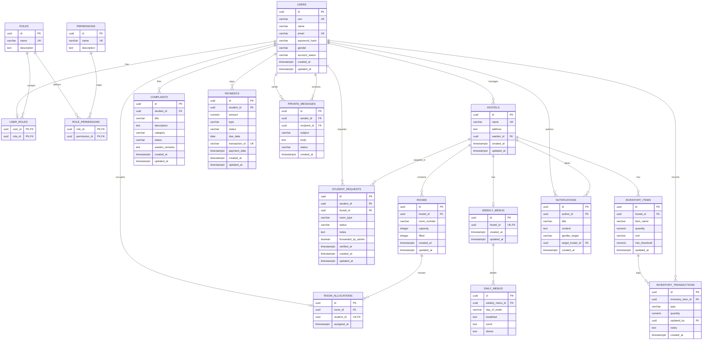

# PostgreSQL Database Schema Design

This document details the robust, relational PostgreSQL schema designed to replace the MongoDB document-based setup. This design ensures strict referential integrity, strong data typing, proper transaction handling, and optimized querying using indexes and constraints.

---

## 1. ER Diagram

The following Mermaid diagram visualizes the tables and relationships within the RNSIT Hostel Management System, including the newly added Mess Kitchen and Inventory tracking.



---

## 2. Table Schemas & Constraints

All tables are designed with explicit data types, primary keys, and foreign keys. UUIDs are used for all IDs to enable distributed generation in microservices.

### 2.1. Core Identity & RBAC Tables

#### `users`
Represents students, wardens, chefs/mess managers, and admins.
```sql
CREATE TABLE users (
    id UUID PRIMARY KEY DEFAULT gen_random_uuid(),
    usn VARCHAR(20) UNIQUE, -- Nullable for Admins/Wardens/Chefs, but unique when present
    name VARCHAR(100) NOT NULL,
    email VARCHAR(150) UNIQUE NOT NULL,
    password_hash VARCHAR(255) NOT NULL,
    gender VARCHAR(10) NOT NULL CHECK (gender IN ('male', 'female', 'other')),
    account_status VARCHAR(20) NOT NULL DEFAULT 'active' CHECK (account_status IN ('active', 'suspended', 'pending')),
    created_at TIMESTAMPTZ NOT NULL DEFAULT NOW(),
    updated_at TIMESTAMPTZ NOT NULL DEFAULT NOW()
);

CREATE INDEX idx_users_usn ON users(usn) WHERE usn IS NOT NULL;
CREATE INDEX idx_users_email ON users(email);
```

#### `roles`
Stores roles like Admin, Warden, Chef/Mess Manager, Student.
```sql
CREATE TABLE roles (
    id UUID PRIMARY KEY DEFAULT gen_random_uuid(),
    name VARCHAR(50) UNIQUE NOT NULL, -- 'ADMIN', 'WARDEN', 'CHEF', 'STUDENT'
    description TEXT,
    created_at TIMESTAMPTZ NOT NULL DEFAULT NOW()
);
```

#### `permissions`
Granular actions, e.g., `hostel:create`, `room:allocate`, `complaint:resolve`, `menu:update`, `inventory:manage`.
```sql
CREATE TABLE permissions (
    id UUID PRIMARY KEY DEFAULT gen_random_uuid(),
    name VARCHAR(100) UNIQUE NOT NULL,
    description TEXT
);
```

#### `user_roles` (Join Table)
Many-to-many relationship mapping users to roles.
```sql
CREATE TABLE user_roles (
    user_id UUID NOT NULL REFERENCES users(id) ON DELETE CASCADE,
    role_id UUID NOT NULL REFERENCES roles(id) ON DELETE CASCADE,
    PRIMARY KEY (user_id, role_id)
);
```

#### `role_permissions` (Join Table)
Many-to-many mapping permissions to roles.
```sql
CREATE TABLE role_permissions (
    role_id UUID NOT NULL REFERENCES roles(id) ON DELETE CASCADE,
    permission_id UUID NOT NULL REFERENCES permissions(id) ON DELETE CASCADE,
    PRIMARY KEY (role_id, permission_id)
);
```

---

### 2.2. Hostel & Room Management Tables

#### `hostels`
Hostel blocks (e.g. "RNSIT Boys Hostel Block A").
```sql
CREATE TABLE hostels (
    id UUID PRIMARY KEY DEFAULT gen_random_uuid(),
    name VARCHAR(100) UNIQUE NOT NULL,
    address TEXT NOT NULL,
    warden_id UUID REFERENCES users(id) ON DELETE SET NULL,
    created_at TIMESTAMPTZ NOT NULL DEFAULT NOW(),
    updated_at TIMESTAMPTZ NOT NULL DEFAULT NOW()
);
```

#### `rooms`
Rooms inside a hostel.
```sql
CREATE TABLE rooms (
    id UUID PRIMARY KEY DEFAULT gen_random_uuid(),
    hostel_id UUID NOT NULL REFERENCES hostels(id) ON DELETE CASCADE,
    room_number VARCHAR(20) NOT NULL,
    capacity INTEGER NOT NULL CHECK (capacity > 0),
    filled INTEGER NOT NULL DEFAULT 0 CHECK (filled >= 0 AND filled <= capacity),
    created_at TIMESTAMPTZ NOT NULL DEFAULT NOW(),
    updated_at TIMESTAMPTZ NOT NULL DEFAULT NOW(),
    UNIQUE (hostel_id, room_number)
);

CREATE INDEX idx_rooms_hostel ON rooms(hostel_id);
```

#### `room_allocations`
Maps which student occupies which room. Referential constraints ensure a student is in at most one room.
```sql
CREATE TABLE room_allocations (
    id UUID PRIMARY KEY DEFAULT gen_random_uuid(),
    room_id UUID NOT NULL REFERENCES rooms(id) ON DELETE CASCADE,
    student_id UUID UNIQUE NOT NULL REFERENCES users(id) ON DELETE CASCADE,
    assigned_at TIMESTAMPTZ NOT NULL DEFAULT NOW()
);

CREATE INDEX idx_allocations_room ON room_allocations(room_id);
```

---

### 2.3. Student Request & Complaint Tables

#### `student_requests`
Housing applications submitted by students.
```sql
CREATE TABLE student_requests (
    id UUID PRIMARY KEY DEFAULT gen_random_uuid(),
    student_id UUID NOT NULL REFERENCES users(id) ON DELETE CASCADE,
    hostel_id UUID NOT NULL REFERENCES hostels(id) ON DELETE CASCADE,
    room_type VARCHAR(20) NOT NULL CHECK (room_type IN ('single', 'double', 'triple', 'dormitory')),
    status VARCHAR(20) NOT NULL DEFAULT 'pending' CHECK (status IN ('pending', 'verified', 'forwarded', 'approved', 'rejected')),
    notes TEXT,
    forwarded_by_admin BOOLEAN NOT NULL DEFAULT FALSE,
    verified_at TIMESTAMPTZ,
    created_at TIMESTAMPTZ NOT NULL DEFAULT NOW(),
    updated_at TIMESTAMPTZ NOT NULL DEFAULT NOW()
);

CREATE INDEX idx_requests_student ON student_requests(student_id);
CREATE INDEX idx_requests_status ON student_requests(status);
```

#### `complaints`
Maintenance and other tickets.
```sql
CREATE TABLE complaints (
    id UUID PRIMARY KEY DEFAULT gen_random_uuid(),
    student_id UUID NOT NULL REFERENCES users(id) ON DELETE CASCADE,
    title VARCHAR(150) NOT NULL,
    description TEXT NOT NULL,
    category VARCHAR(30) NOT NULL CHECK (category IN ('maintenance', 'mess', 'security', 'other')),
    status VARCHAR(20) NOT NULL DEFAULT 'pending' CHECK (status IN ('pending', 'in-progress', 'resolved', 'closed')),
    warden_remarks TEXT,
    created_at TIMESTAMPTZ NOT NULL DEFAULT NOW(),
    updated_at TIMESTAMPTZ NOT NULL DEFAULT NOW()
);

CREATE INDEX idx_complaints_student ON complaints(student_id);
CREATE INDEX idx_complaints_status ON complaints(status);
```

---

### 2.4. Mess Menu Tables

#### `weekly_menus`
```sql
CREATE TABLE weekly_menus (
    id UUID PRIMARY KEY DEFAULT gen_random_uuid(),
    hostel_id UUID UNIQUE NOT NULL REFERENCES hostels(id) ON DELETE CASCADE,
    created_at TIMESTAMPTZ NOT NULL DEFAULT NOW(),
    updated_at TIMESTAMPTZ NOT NULL DEFAULT NOW()
);
```

#### `daily_menus`
Specific schedules for meals by day.
```sql
CREATE TABLE daily_menus (
    id UUID PRIMARY KEY DEFAULT gen_random_uuid(),
    weekly_menu_id UUID NOT NULL REFERENCES weekly_menus(id) ON DELETE CASCADE,
    day_of_week VARCHAR(15) NOT NULL CHECK (day_of_week IN ('monday', 'tuesday', 'wednesday', 'thursday', 'friday', 'saturday', 'sunday')),
    breakfast TEXT NOT NULL DEFAULT 'Not Set',
    lunch TEXT NOT NULL DEFAULT 'Not Set',
    dinner TEXT NOT NULL DEFAULT 'Not Set',
    UNIQUE (weekly_menu_id, day_of_week)
);
```

---

### 2.5. Mess & Kitchen Inventory Tables

#### `inventory_items`
Holds ingredient and supply stocks for the hostel mess kitchen.
```sql
CREATE TABLE inventory_items (
    id UUID PRIMARY KEY DEFAULT gen_random_uuid(),
    hostel_id UUID NOT NULL REFERENCES hostels(id) ON DELETE CASCADE,
    item_name VARCHAR(100) NOT NULL,
    quantity NUMERIC(10, 2) NOT NULL DEFAULT 0.00 CHECK (quantity >= 0.00),
    unit VARCHAR(20) NOT NULL, -- 'kg', 'litres', 'bags', 'units'
    min_threshold NUMERIC(10, 2) NOT NULL DEFAULT 0.00 CHECK (min_threshold >= 0.00),
    updated_at TIMESTAMPTZ NOT NULL DEFAULT NOW(),
    UNIQUE (hostel_id, item_name)
);

CREATE INDEX idx_inventory_hostel ON inventory_items(hostel_id);
```

#### `inventory_transactions`
Logs raw material audits (additions or usages).
```sql
CREATE TABLE inventory_transactions (
    id UUID PRIMARY KEY DEFAULT gen_random_uuid(),
    inventory_item_id UUID NOT NULL REFERENCES inventory_items(id) ON DELETE CASCADE,
    type VARCHAR(10) NOT NULL CHECK (type IN ('IN', 'OUT')),
    quantity NUMERIC(10, 2) NOT NULL CHECK (quantity > 0.00),
    updated_by UUID NOT NULL REFERENCES users(id),
    notes TEXT,
    created_at TIMESTAMPTZ NOT NULL DEFAULT NOW()
);

CREATE INDEX idx_inv_tx_item ON inventory_transactions(inventory_item_id);
```

---

### 2.6. ERP Billing & Payments

#### `payments`
Fee schedules and collections.
```sql
CREATE TABLE payments (
    id UUID PRIMARY KEY DEFAULT gen_random_uuid(),
    student_id UUID NOT NULL REFERENCES users(id) ON DELETE CASCADE,
    amount NUMERIC(10, 2) NOT NULL CHECK (amount >= 0),
    type VARCHAR(30) NOT NULL CHECK (type IN ('hostel_fee', 'mess_fee', 'security_deposit', 'other')),
    status VARCHAR(20) NOT NULL DEFAULT 'due' CHECK (status IN ('paid', 'due', 'overdue')),
    due_date DATE NOT NULL,
    transaction_id VARCHAR(100) UNIQUE,
    payment_date TIMESTAMPTZ,
    created_at TIMESTAMPTZ NOT NULL DEFAULT NOW(),
    updated_at TIMESTAMPTZ NOT NULL DEFAULT NOW()
);

CREATE INDEX idx_payments_student ON payments(student_id);
```

---

### 2.7. ERP Messaging & Announcements

#### `notifications`
Targeted broadcasts.
```sql
CREATE TABLE notifications (
    id UUID PRIMARY KEY DEFAULT gen_random_uuid(),
    author_id UUID NOT NULL REFERENCES users(id) ON DELETE CASCADE,
    title VARCHAR(150) NOT NULL,
    content TEXT NOT NULL,
    gender_target VARCHAR(10) CHECK (gender_target IN ('male', 'female', 'all')),
    target_hostel_id UUID REFERENCES hostels(id) ON DELETE SET NULL,
    created_at TIMESTAMPTZ NOT NULL DEFAULT NOW()
);
```

#### `private_messages`
Peer communications.
```sql
CREATE TABLE private_messages (
    id UUID PRIMARY KEY DEFAULT gen_random_uuid(),
    sender_id UUID NOT NULL REFERENCES users(id) ON DELETE CASCADE,
    recipient_id UUID NOT NULL REFERENCES users(id) ON DELETE CASCADE,
    subject VARCHAR(150) NOT NULL DEFAULT 'General Notice',
    body TEXT NOT NULL,
    status VARCHAR(20) NOT NULL DEFAULT 'sent' CHECK (status IN ('sent', 'read', 'actioned')),
    created_at TIMESTAMPTZ NOT NULL DEFAULT NOW()
);

CREATE INDEX idx_messages_sender ON private_messages(sender_id);
CREATE INDEX idx_messages_recipient ON private_messages(recipient_id);
```

---

## 3. Database Triggers & Functions (Automation)

To prevent the data integrity bugs of the current MongoDB hooks (where client-side code syncs capacity manually), PostgreSQL handles room filling automatically via transactional functions.

### 3.1. Automatic `filled` Increment/Decrement
When a student is assigned to or removed from a room, update the `filled` count inside the `rooms` table.

```sql
CREATE OR REPLACE FUNCTION update_room_filled_count()
RETURNS TRIGGER AS $$
BEGIN
    IF (TG_OP = 'INSERT') THEN
        -- Check if room capacity is already full
        IF (SELECT filled FROM rooms WHERE id = NEW.room_id) >= (SELECT capacity FROM rooms WHERE id = NEW.room_id) THEN
            RAISE EXCEPTION 'Room capacity exceeded. Cannot assign student.';
        END IF;

        UPDATE rooms 
        SET filled = filled + 1, updated_at = NOW() 
        WHERE id = NEW.room_id;
        
    ELSIF (TG_OP = 'DELETE') THEN
        UPDATE rooms 
        SET filled = GREATEST(filled - 1, 0), updated_at = NOW() 
        WHERE id = OLD.room_id;
        
    ELSIF (TG_OP = 'UPDATE') THEN
        -- If student moved rooms
        IF OLD.room_id <> NEW.room_id THEN
            -- Decrease old room filled count
            UPDATE rooms 
            SET filled = GREATEST(filled - 1, 0), updated_at = NOW() 
            WHERE id = OLD.room_id;
            
            -- Check and increase new room filled count
            IF (SELECT filled FROM rooms WHERE id = NEW.room_id) >= (SELECT capacity FROM rooms WHERE id = NEW.room_id) THEN
                RAISE EXCEPTION 'Room capacity exceeded. Cannot transfer student.';
            END IF;

            UPDATE rooms 
            SET filled = filled + 1, updated_at = NOW() 
            WHERE id = NEW.room_id;
        END IF;
    END IF;
    RETURN NULL;
END;
$$ LANGUAGE plpgsql;

CREATE TRIGGER trg_sync_room_occupancy
AFTER INSERT OR UPDATE OR DELETE ON room_allocations
FOR EACH ROW EXECUTE FUNCTION update_room_filled_count();
```

### 3.2. Automatic Inventory Balance Sync
When an inventory transaction is recorded, update the quantity balance in `inventory_items` and raise warnings if below minimum threshold.
```sql
CREATE OR REPLACE FUNCTION process_inventory_transaction()
RETURNS TRIGGER AS $$
DECLARE
    current_qty NUMERIC(10,2);
    item_unit VARCHAR(20);
    threshold NUMERIC(10,2);
    item_name_var VARCHAR(100);
BEGIN
    -- Fetch current state
    SELECT quantity, unit, min_threshold, item_name 
    INTO current_qty, item_unit, threshold, item_name_var
    FROM inventory_items 
    WHERE id = NEW.inventory_item_id;

    -- Calculate new quantity
    IF NEW.type = 'IN' THEN
        current_qty := current_qty + NEW.quantity;
    ELSIF NEW.type = 'OUT' THEN
        IF current_qty < NEW.quantity THEN
            RAISE EXCEPTION 'Insufficient inventory. Available: % %, Requested: % %', current_qty, item_unit, NEW.quantity, item_unit;
        END IF;
        current_qty := current_qty - NEW.quantity;
    END IF;

    -- Update inventory items
    UPDATE inventory_items
    SET quantity = current_qty, updated_at = NOW()
    WHERE id = NEW.inventory_item_id;

    RETURN NEW;
END;
$$ LANGUAGE plpgsql;

CREATE TRIGGER trg_process_inventory_tx
BEFORE INSERT ON inventory_transactions
FOR EACH ROW EXECUTE FUNCTION process_inventory_transaction();
```
